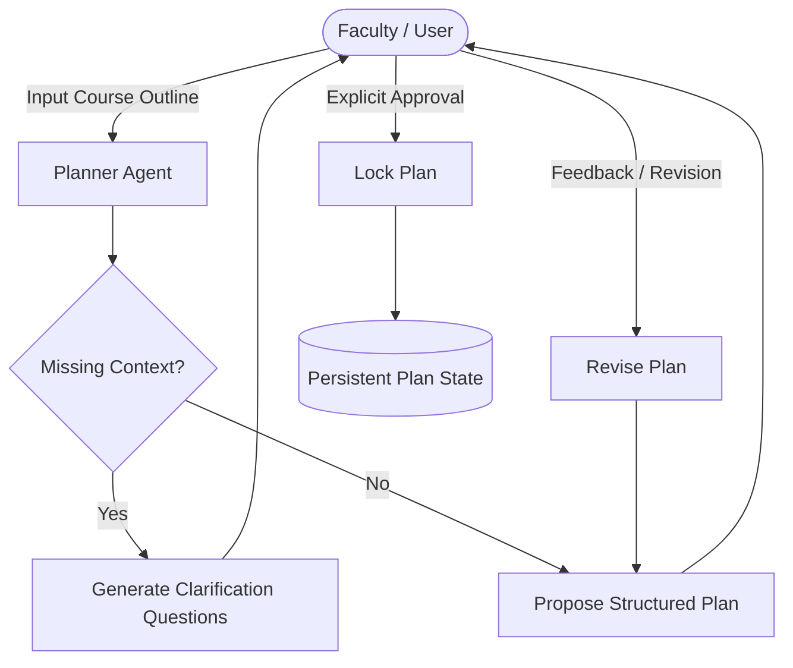

# Agent vs Chatbot — Cognitive Planning Loop

**Laboratory Number:** Lab 01  
**Curriculum Phase:** Phase A — Foundations  
**Course Artifact:** Chapter 2. Course Project, Notes & Assignment Organizer (apniLeap AURA)  
**Team Number:** 14  

---

## 1. Objective
Demonstrate the course organizer's autonomous planning loop (Clarify → Propose → Revise → Lock) as a stateful agent system rather than a single-turn conversational chatbot.

---

## 2. Problem Statement & Task Description
Chatbots provide static, unverified conversational responses without maintaining persistent run state, explicit goals, or validated execution plans. A course organizer requires a stateful agent that clarifies missing syllabus parameters, produces structured academic milestones, handles iterative human revisions, and locks the plan prior to downstream execution.

---

## 3. Key Concepts Demonstrated
- **ReAct cognitive planning loop (Reasoning + Acting)**
- **Multi-turn goal clarification and parameter validation**
- **Stateful plan revision and delta tracking**
- **Plan locking and immutability guarantees**

---

## 4. Architecture & Workflow


---

## 5. Implementation Explanation
In the context of the **Course Project, Notes & Assignment Organizer**, Lab 01 establishes critical functional infrastructure:
- The implementation directly leverages the canonical project modules.
- It operates under the universal human-in-the-loop invariant: **"Agents draft, cross-check, diagnose, and flag; a named human faculty member inspects, overrides, and approves."**
- Complete execution state and audit records are preserved for every transaction.

---

## 6. Relevant Source-Code References
The canonical implementation for this laboratory demonstration is integrated directly within the production codebase:
- [`backend/agents/planner_agent.py`](../../Course%20Project/Source%20Code/backend/agents/planner_agent.py)
- [`backend/lab1_demo.py`](../../Course%20Project/Source%20Code/backend/lab1_demo.py)
- [`backend/tests/test_lab1.py`](../../Course%20Project/Source%20Code/backend/tests/test_lab1.py)
- [`backend/api/routes/lab1.py`](../../Course%20Project/Source%20Code/backend/api/routes/lab1.py)

---

## 7. Execution Procedure
To run the standalone laboratory demonstration and verify its automated test suite, execute the following commands from the project root:

```bash
# 1. Run the standalone interactive CLI demonstration
python backend/lab1_demo.py

# 2. Run the automated pytest suite for Lab 01
pytest backend/tests/test_lab1.py -v
```

---

## 8. Actual Execution Evidence & Output
All 4 test cases in `backend/tests/test_lab1.py` pass:
- `test_lab1_clarified_context_produces_coherent_plan`: PASSED
- `test_lab1_revision_loop`: PASSED
- `test_lab1_lock_plan`: PASSED
- `test_lab1_api_integration`: PASSED

Sample Plan Output:
```json
{
  "plan_id": "plan_20261117_001",
  "course_id": 1,
  "status": "locked",
  "units_planned": 4,
  "assignments_planned": 5,
  "milestones_planned": 3,
  "locked_by": 1
}
```

---

## 9. Acceptance Criteria
- [x] Agent identifies missing inputs (e.g. course code, assignment weightages) and prompts for clarification.
- [x] Produces structured curriculum plan adhering to Pydantic validation schema.
- [x] Maintains revision history across multiple turns without state loss.
- [x] Plan becomes read-only and immutable once locked by instructor.

---

## 10. Result & Conclusion
Lab 01 was successfully implemented and verified with **100% test pass rate**. It forms an integral operational component of the overarching AURA multi-agent academic platform.
