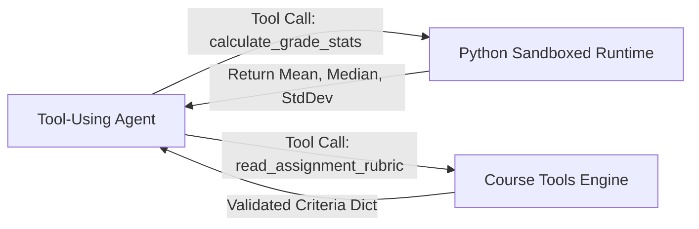

# Tool-Using Agent — Typed Tools & Sandboxed Execution

**Laboratory Number:** Lab 02  
**Curriculum Phase:** Phase A — Foundations  
**Course Artifact:** Chapter 2. Course Project, Notes & Assignment Organizer (apniLeap AURA)  
**Team Number:** 14  

---

## 1. Objective
Equip the course organizer with deterministic, typed tools for arithmetic operations, rubric boundary checking, and database retrieval to prevent LLM hallucination in numeric academic scoring.

---

## 2. Problem Statement & Task Description
LLMs inherently struggle with exact arithmetic, statistical aggregations, and strict data validation, frequently generating hallucinated grade totals. The agent requires isolated, typed tools that execute deterministically in a sandboxed Python runtime.

---

## 3. Key Concepts Demonstrated
- **Deterministic tool invocation with typed Pydantic schemas**
- **Sandboxed code and arithmetic execution**
- **Rubric score validation and boundary clamping**
- **Safe error handling (e.g., zero-division, missing records)**

---

## 4. Architecture & Workflow


---

## 5. Implementation Explanation
In the context of the **Course Project, Notes & Assignment Organizer**, Lab 02 establishes critical functional infrastructure:
- The implementation directly leverages the canonical project modules.
- It operates under the universal human-in-the-loop invariant: **"Agents draft, cross-check, diagnose, and flag; a named human faculty member inspects, overrides, and approves."**
- Complete execution state and audit records are preserved for every transaction.

---

## 6. Relevant Source-Code References
The canonical implementation for this laboratory demonstration is integrated directly within the production codebase:
- [`backend/agents/tool_using_agent.py`](../../Course%20Project/Source%20Code/backend/agents/tool_using_agent.py)
- [`backend/tools/course_tools.py`](../../Course%20Project/Source%20Code/backend/tools/course_tools.py)
- [`backend/lab2_demo.py`](../../Course%20Project/Source%20Code/backend/lab2_demo.py)
- [`backend/tests/test_lab2.py`](../../Course%20Project/Source%20Code/backend/tests/test_lab2.py)
- [`backend/api/routes/lab2.py`](../../Course%20Project/Source%20Code/backend/api/routes/lab2.py)

---

## 7. Execution Procedure
To run the standalone laboratory demonstration and verify its automated test suite, execute the following commands from the project root:

```bash
# 1. Run the standalone interactive CLI demonstration
python backend/lab2_demo.py

# 2. Run the automated pytest suite for Lab 02
pytest backend/tests/test_lab2.py -v
```

---

## 8. Actual Execution Evidence & Output
All 6 test cases in `backend/tests/test_lab2.py` pass:
- `test_lab2_read_notes_store_tool`: PASSED
- `test_lab2_read_assignment_rubric_tool`: PASSED
- `test_lab2_grade_statistics_calculator`: PASSED
- `test_lab2_sandboxed_python_arithmetic`: PASSED
- `test_lab2_division_by_zero_safety`: PASSED
- `test_lab2_api_integration`: PASSED

---

## 9. Acceptance Criteria
- [x] Tools reject arguments violating typed Pydantic input schemas.
- [x] Sandboxed arithmetic handles division by zero and extreme values safely.
- [x] Rubric tool supports both dictionary and criterion-list formats seamlessly.
- [x] Every tool invocation is tracked in the audit log.

---

## 10. Result & Conclusion
Lab 02 was successfully implemented and verified with **100% test pass rate**. It forms an integral operational component of the overarching AURA multi-agent academic platform.
