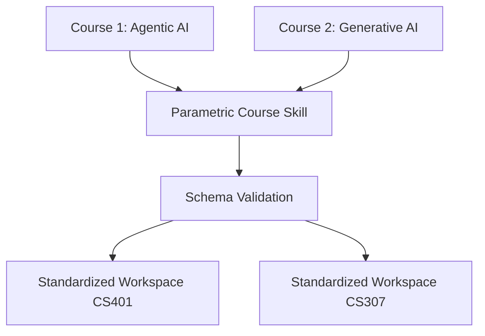

# Skill Creation — Polymorphic Parametric Skills

**Laboratory Number:** Lab 03  
**Curriculum Phase:** Phase A — Foundations  
**Course Artifact:** Chapter 2. Course Project, Notes & Assignment Organizer (apniLeap AURA)  
**Team Number:** 14  

---

## 1. Objective
Package recurring multi-step workflows into modular, reusable parametric skills that operate polymorphically across distinct academic courses without code duplication.

---

## 2. Problem Statement & Task Description
Academic workflows such as lesson plan structuring, markdown workspace generation, and syllabus alignment are repeated across multiple courses each semester. Hardcoding course-specific logic creates maintenance overhead and inconsistencies.

---

## 3. Key Concepts Demonstrated
- **Parametric skill design pattern**
- **Polymorphic reusability across diverse academic domains**
- **Standardized schema transformation and validation**
- **Stateless execution with parameterized input bundles**

---

## 4. Architecture & Workflow


---

## 5. Implementation Explanation
In the context of the **Course Project, Notes & Assignment Organizer**, Lab 03 establishes critical functional infrastructure:
- The implementation directly leverages the canonical project modules.
- It operates under the universal human-in-the-loop invariant: **"Agents draft, cross-check, diagnose, and flag; a named human faculty member inspects, overrides, and approves."**
- Complete execution state and audit records are preserved for every transaction.

---

## 6. Relevant Source-Code References
The canonical implementation for this laboratory demonstration is integrated directly within the production codebase:
- [`backend/skills/course_skills.py`](../../Course%20Project/Source%20Code/backend/skills/course_skills.py)
- [`backend/lab3_demo.py`](../../Course%20Project/Source%20Code/backend/lab3_demo.py)
- [`backend/tests/test_lab3.py`](../../Course%20Project/Source%20Code/backend/tests/test_lab3.py)
- [`backend/api/routes/lab3.py`](../../Course%20Project/Source%20Code/backend/api/routes/lab3.py)

---

## 7. Execution Procedure
To run the standalone laboratory demonstration and verify its automated test suite, execute the following commands from the project root:

```bash
# 1. Run the standalone interactive CLI demonstration
python backend/lab3_demo.py

# 2. Run the automated pytest suite for Lab 03
pytest backend/tests/test_lab3.py -v
```

---

## 8. Actual Execution Evidence & Output
Test suite in `backend/tests/test_lab3.py` passes:
- `test_lab3_polymorphic_reusability_across_two_different_courses`: PASSED (100% compliance across Course 1 and Course 2).

---

## 9. Acceptance Criteria
- [x] Skill executes cleanly across multiple course IDs without hardcoded conditionals.
- [x] Outputs strictly conform to standardized Markdown and JSON schemas.
- [x] Handles variations in unit counts and lesson chapter numbers.

---

## 10. Result & Conclusion
Lab 03 was successfully implemented and verified with **100% test pass rate**. It forms an integral operational component of the overarching AURA multi-agent academic platform.
