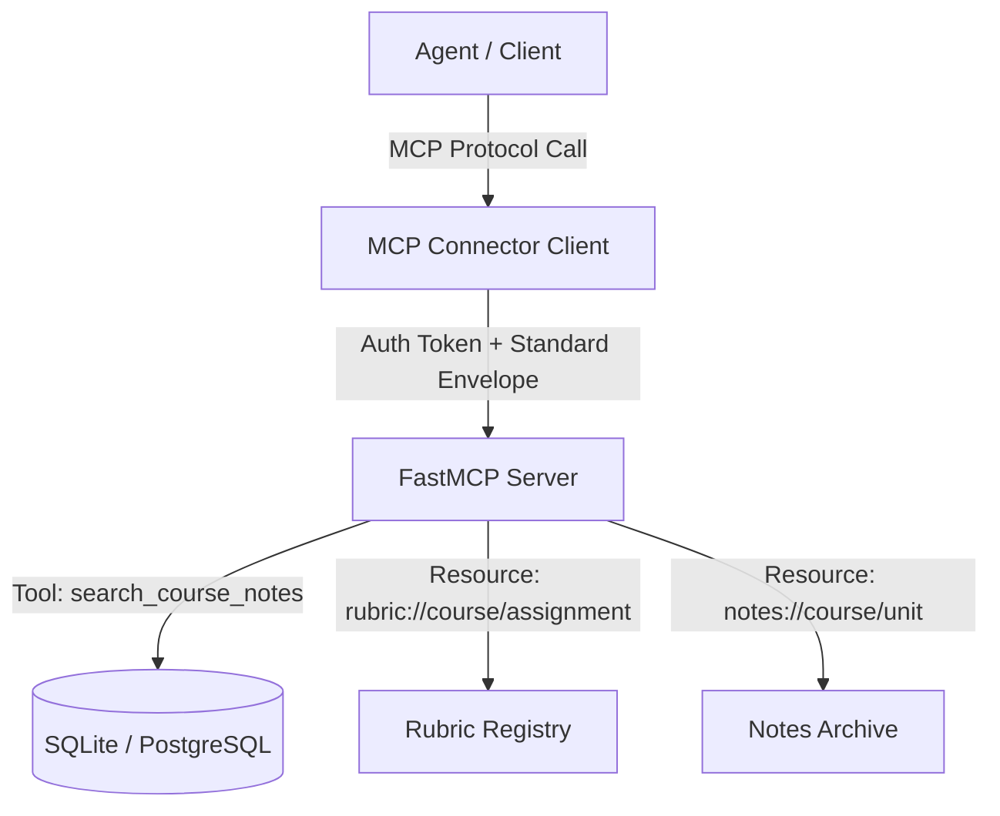

# Model Context Protocol — FastMCP Connector & Resources

**Laboratory Number:** Lab 05  
**Curriculum Phase:** Phase A — Foundations  
**Course Artifact:** Chapter 2. Course Project, Notes & Assignment Organizer (apniLeap AURA)  
**Team Number:** 14  

---

## 1. Objective
Standardize data access and tool execution through an enterprise Model Context Protocol (FastMCP) server and connector client with custom academic URI schemes.

---

## 2. Problem Statement & Task Description
Direct database queries and ad-hoc HTTP endpoints tightly couple agents to specific database engines and lack standardized discoverability, auth tokens, and resource introspection.

---

## 3. Key Concepts Demonstrated
- **Model Context Protocol (MCP) tool and resource abstractions**
- **Standardized academic URI schemes (`notes://`, `rubric://`, `assignment://`, `milestones://`)**
- **Streamable HTTP and in-process connector transports**
- **Bearer token authentication and latency profiling**

---

## 4. Architecture & Workflow


---

## 5. Implementation Explanation
In the context of the **Course Project, Notes & Assignment Organizer**, Lab 05 establishes critical functional infrastructure:
- The implementation directly leverages the canonical project modules.
- It operates under the universal human-in-the-loop invariant: **"Agents draft, cross-check, diagnose, and flag; a named human faculty member inspects, overrides, and approves."**
- Complete execution state and audit records are preserved for every transaction.

---

## 6. Relevant Source-Code References
The canonical implementation for this laboratory demonstration is integrated directly within the production codebase:
- [`backend/mcp_server/course_mcp_server.py`](../../Course%20Project/Source%20Code/backend/mcp_server/course_mcp_server.py)
- [`backend/connector/mcp_connector_client.py`](../../Course%20Project/Source%20Code/backend/connector/mcp_connector_client.py)
- [`backend/lab5_demo.py`](../../Course%20Project/Source%20Code/backend/lab5_demo.py)
- [`backend/tests/test_lab5.py`](../../Course%20Project/Source%20Code/backend/tests/test_lab5.py)
- [`backend/api/routes/lab5.py`](../../Course%20Project/Source%20Code/backend/api/routes/lab5.py)

---

## 7. Execution Procedure
To run the standalone laboratory demonstration and verify its automated test suite, execute the following commands from the project root:

```bash
# 1. Run the standalone interactive CLI demonstration
python backend/lab5_demo.py

# 2. Run the automated pytest suite for Lab 05
pytest backend/tests/test_lab5.py -v
```

---

## 8. Actual Execution Evidence & Output
All 5 test cases in `backend/tests/test_lab5.py` pass:
- `test_lab5_read_notes_via_mcp_connector`: PASSED
- `test_lab5_read_rubric_via_mcp_connector`: PASSED
- `test_lab5_mcp_resource_uris`: PASSED
- `test_lab5_mcp_client_auth_failure`: PASSED
- `test_lab5_api_integration`: PASSED

---

## 9. Acceptance Criteria
- [x] FastMCP exposes all standard tools (`search_course_notes`, `get_rubric`, `get_assignments`, `validate_assignment`).
- [x] Resources resolve properly under `notes://`, `rubric://`, `assignment://`, and `milestones://` URIs.
- [x] Connector rejects unauthenticated requests with 401 Unauthorized.

---

## 10. Result & Conclusion
Lab 05 was successfully implemented and verified with **100% test pass rate**. It forms an integral operational component of the overarching AURA multi-agent academic platform.
