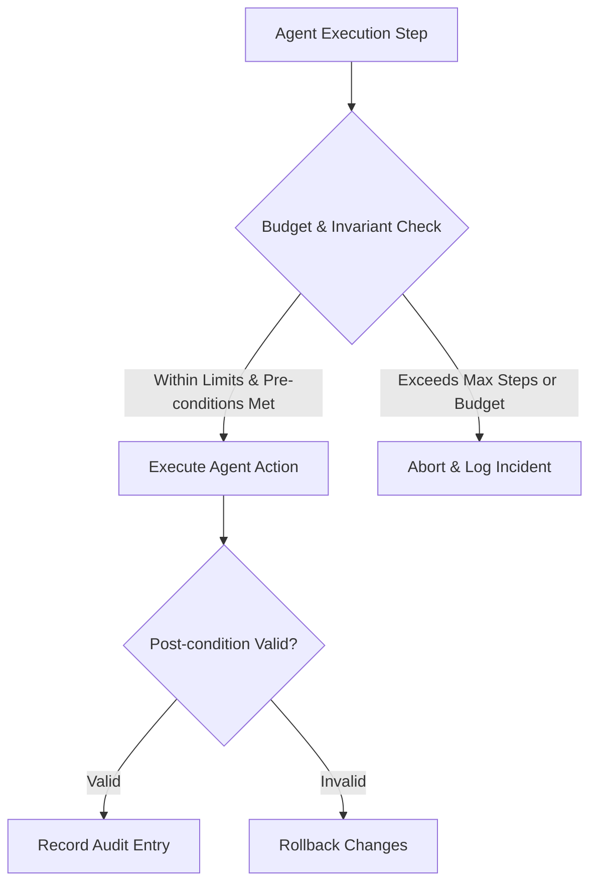

# Governed Runtime — Step Budgets & Invariant Enforcement

**Laboratory Number:** Lab 06  
**Curriculum Phase:** Phase A — Foundations  
**Course Artifact:** Chapter 2. Course Project, Notes & Assignment Organizer (apniLeap AURA)  
**Team Number:** 14  

---

## 1. Objective
Construct a deterministic runtime supervisor that enforces execution step budgets, token consumption ceilings, pre/post-condition invariants, and immutable audit logs.

---

## 2. Problem Statement & Task Description
Autonomous agent loops risk entering infinite retry cascades, exceeding LLM budget allowances, or violating business invariants (e.g. grading an uncollected submission).

---

## 3. Key Concepts Demonstrated
- **Runtime budget limits (Max Steps, Max Cost Tokens, Timeout)**
- **Pre-condition and post-condition invariant verification**
- **Fail-closed execution guarantees**
- **Cryptographically traceable audit logging with UTC timestamps**

---

## 4. Architecture & Workflow


---

## 5. Implementation Explanation
In the context of the **Course Project, Notes & Assignment Organizer**, Lab 06 establishes critical functional infrastructure:
- The implementation directly leverages the canonical project modules.
- It operates under the universal human-in-the-loop invariant: **"Agents draft, cross-check, diagnose, and flag; a named human faculty member inspects, overrides, and approves."**
- Complete execution state and audit records are preserved for every transaction.

---

## 6. Relevant Source-Code References
The canonical implementation for this laboratory demonstration is integrated directly within the production codebase:
- [`backend/runtime/governed_runtime.py`](../../Course%20Project/Source%20Code/backend/runtime/governed_runtime.py)
- [`backend/runtime/audit.py`](../../Course%20Project/Source%20Code/backend/runtime/audit.py)
- [`backend/lab6_demo.py`](../../Course%20Project/Source%20Code/backend/lab6_demo.py)
- [`backend/tests/test_lab6.py`](../../Course%20Project/Source%20Code/backend/tests/test_lab6.py)
- [`backend/api/routes/lab6.py`](../../Course%20Project/Source%20Code/backend/api/routes/lab6.py)

---

## 7. Execution Procedure
To run the standalone laboratory demonstration and verify its automated test suite, execute the following commands from the project root:

```bash
# 1. Run the standalone interactive CLI demonstration
python backend/lab6_demo.py

# 2. Run the automated pytest suite for Lab 06
pytest backend/tests/test_lab6.py -v
```

---

## 8. Actual Execution Evidence & Output
All 4 test cases in `backend/tests/test_lab6.py` pass:
- `test_lab6_step_budget_exhaustion_fails_closed`: PASSED
- `test_lab6_precondition_invariant_enforcement`: PASSED
- `test_lab6_audit_log_traceability`: PASSED
- `test_lab6_api_integration`: PASSED

---

## 9. Acceptance Criteria
- [x] Runtime terminates immediately and fails closed if step count exceeds `max_steps`.
- [x] Rejects operations whose pre-conditions are unsatisfied.
- [x] Every step records actor ID, agent name, action, and JSON payload in audit log.

---

## 10. Result & Conclusion
Lab 06 was successfully implemented and verified with **100% test pass rate**. It forms an integral operational component of the overarching AURA multi-agent academic platform.
