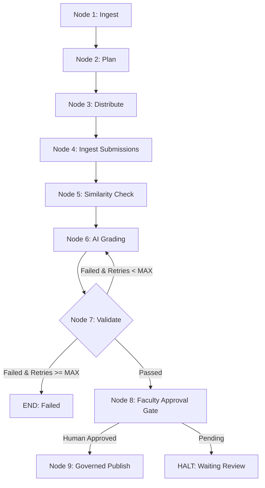

# LangGraph Orchestration — 9-Node Cyclic StateGraph

**Laboratory Number:** Lab 07  
**Curriculum Phase:** Phase B — Orchestration  
**Course Artifact:** Chapter 2. Course Project, Notes & Assignment Organizer (apniLeap AURA)  
**Team Number:** 14  

---

## 1. Objective
Implement an end-to-end cyclic LangGraph StateGraph pipeline featuring specialist agent nodes, self-healing validation retry loops, and a mandatory Faculty Approval Gate.

---

## 2. Problem Statement & Task Description
Linear scripts cannot represent real-world academic workflows that require conditional regrading on rubric failure, dynamic routing, and explicit human-in-the-loop pauses.

---

## 3. Key Concepts Demonstrated
- **LangGraph StateGraph cyclic architecture**
- **Typed CourseGraphState shared context**
- **Self-healing validation back-edge with bounded retries**
- **Human-in-the-loop Faculty Gate pause and approval**

---

## 4. Architecture & Workflow


---

## 5. Implementation Explanation
In the context of the **Course Project, Notes & Assignment Organizer**, Lab 07 establishes critical functional infrastructure:
- The implementation directly leverages the canonical project modules.
- It operates under the universal human-in-the-loop invariant: **"Agents draft, cross-check, diagnose, and flag; a named human faculty member inspects, overrides, and approves."**
- Complete execution state and audit records are preserved for every transaction.

---

## 6. Relevant Source-Code References
The canonical implementation for this laboratory demonstration is integrated directly within the production codebase:
- [`backend/agents/node_graph_pipeline.py`](../../Course%20Project/Source%20Code/backend/agents/node_graph_pipeline.py)
- [`backend/runtime/workflow_persistence_service.py`](../../Course%20Project/Source%20Code/backend/runtime/workflow_persistence_service.py)
- [`backend/lab7_demo.py`](../../Course%20Project/Source%20Code/backend/lab7_demo.py)
- [`backend/tests/test_lab7.py`](../../Course%20Project/Source%20Code/backend/tests/test_lab7.py)
- [`backend/api/routes/lab7.py`](../../Course%20Project/Source%20Code/backend/api/routes/lab7.py)

---

## 7. Execution Procedure
To run the standalone laboratory demonstration and verify its automated test suite, execute the following commands from the project root:

```bash
# 1. Run the standalone interactive CLI demonstration
python backend/lab7_demo.py

# 2. Run the automated pytest suite for Lab 07
pytest backend/tests/test_lab7.py -v
```

---

## 8. Actual Execution Evidence & Output
All 19 test cases in `backend/tests/test_lab7.py` pass:
- `TestNodeIngest`: 2/2 PASSED
- `TestNodePlan`: 2/2 PASSED
- `TestNodeSimilarity`: 2/2 PASSED
- `TestNodeGrading`: 3/3 PASSED
- `TestNodeValidate`: 3/3 PASSED
- `TestEdgeValidateRouter`: 3/3 PASSED
- `TestFacultyGate`: 2/2 PASSED
- `TestPipelineRunnerIntegration`: 2/2 PASSED

---

## 9. Acceptance Criteria
- [x] Graph transitions across all 9 nodes smoothly.
- [x] Retry loop re-evaluates grades when rubric validation fails.
- [x] Execution halts at Faculty Gate until explicit human approval is supplied.

---

## 10. Result & Conclusion
Lab 07 was successfully implemented and verified with **100% test pass rate**. It forms an integral operational component of the overarching AURA multi-agent academic platform.
