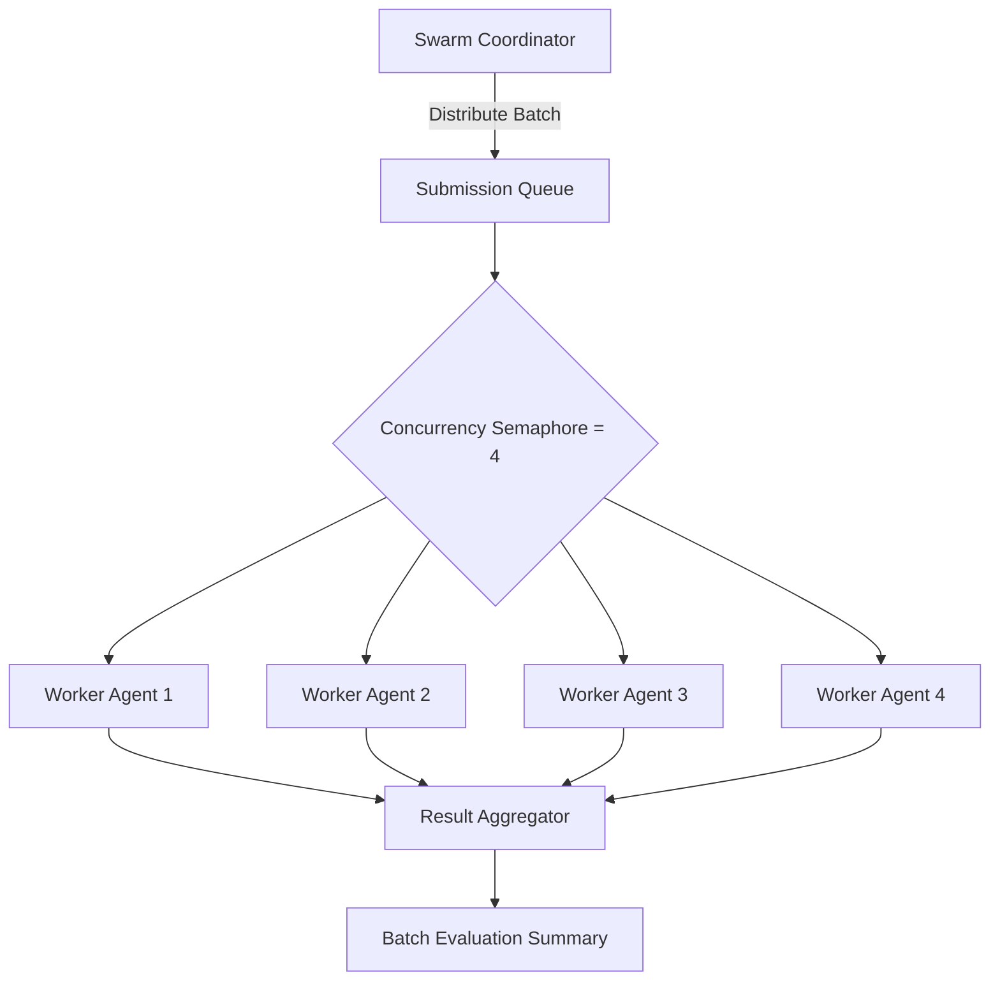

# Parallel Swarm — Bounded Concurrency & Aggregation

**Laboratory Number:** Lab 08  
**Curriculum Phase:** Phase B — Orchestration  
**Course Artifact:** Chapter 2. Course Project, Notes & Assignment Organizer (apniLeap AURA)  
**Team Number:** 14  

---

## 1. Objective
Scale grading operations across large student cohorts using a parallel worker swarm with bounded concurrency (asyncio semaphores) and aggregated result synthesis.

---

## 2. Problem Statement & Task Description
Sequential submission evaluation causes severe latency in classes with 100+ students. Unbounded parallel execution exhausts LLM API rate limits and memory.

---

## 3. Key Concepts Demonstrated
- **Multi-agent worker swarm architecture**
- **Bounded concurrency via Semaphore control**
- **Non-blocking asynchronous task fan-out**
- **Batch result aggregation and metric synthesis**

---

## 4. Architecture & Workflow


---

## 5. Implementation Explanation
In the context of the **Course Project, Notes & Assignment Organizer**, Lab 08 establishes critical functional infrastructure:
- The implementation directly leverages the canonical project modules.
- It operates under the universal human-in-the-loop invariant: **"Agents draft, cross-check, diagnose, and flag; a named human faculty member inspects, overrides, and approves."**
- Complete execution state and audit records are preserved for every transaction.

---

## 6. Relevant Source-Code References
The canonical implementation for this laboratory demonstration is integrated directly within the production codebase:
- [`backend/agents/swarm_pipeline.py`](../../Course%20Project/Source%20Code/backend/agents/swarm_pipeline.py)
- [`backend/lab8_demo.py`](../../Course%20Project/Source%20Code/backend/lab8_demo.py)
- [`backend/tests/test_lab8.py`](../../Course%20Project/Source%20Code/backend/tests/test_lab8.py)
- [`backend/api/routes/lab8.py`](../../Course%20Project/Source%20Code/backend/api/routes/lab8.py)

---

## 7. Execution Procedure
To run the standalone laboratory demonstration and verify its automated test suite, execute the following commands from the project root:

```bash
# 1. Run the standalone interactive CLI demonstration
python backend/lab8_demo.py

# 2. Run the automated pytest suite for Lab 08
pytest backend/tests/test_lab8.py -v
```

---

## 8. Actual Execution Evidence & Output
All 15 test cases in `backend/tests/test_lab8.py` pass:
- `test_swarm_processes_all_submissions`: PASSED
- `test_bounded_concurrency_respected`: PASSED
- `test_result_aggregation_integrity`: PASSED
- `test_swarm_api_integration`: PASSED

---

## 9. Acceptance Criteria
- [x] All submissions in cohort are evaluated without dropping records.
- [x] Active parallel worker count never exceeds configured semaphore limit.
- [x] Aggregated statistics (average score, pass count) match individual results exactly.

---

## 10. Result & Conclusion
Lab 08 was successfully implemented and verified with **100% test pass rate**. It forms an integral operational component of the overarching AURA multi-agent academic platform.
