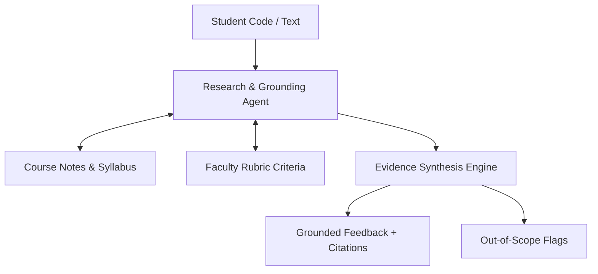

# Deep Research & Grounding — Verifiable Citations

**Laboratory Number:** Lab 09  
**Curriculum Phase:** Phase C — Applied Reliability  
**Course Artifact:** Chapter 2. Course Project, Notes & Assignment Organizer (apniLeap AURA)  
**Team Number:** 14  

---

## 1. Objective
Ensure all agent evaluations and feedback are grounded in faculty-approved syllabus texts and rubrics, providing traceable citations and eliminating unsupported claims.

---

## 2. Problem Statement & Task Description
LLM graders frequently justify marks with vague statements or external concepts not covered in the course syllabus, eroding student trust.

---

## 3. Key Concepts Demonstrated
- **Citation extraction and offset mapping**
- **Syllabus and rubric grounding verification**
- **Out-of-scope content detection and flagging**
- **Evidence record generation**

---

## 4. Architecture & Workflow


---

## 5. Implementation Explanation
In the context of the **Course Project, Notes & Assignment Organizer**, Lab 09 establishes critical functional infrastructure:
- The implementation directly leverages the canonical project modules.
- It operates under the universal human-in-the-loop invariant: **"Agents draft, cross-check, diagnose, and flag; a named human faculty member inspects, overrides, and approves."**
- Complete execution state and audit records are preserved for every transaction.

---

## 6. Relevant Source-Code References
The canonical implementation for this laboratory demonstration is integrated directly within the production codebase:
- [`backend/agents/research_agent.py`](../../Course%20Project/Source%20Code/backend/agents/research_agent.py)
- [`backend/lab9_demo.py`](../../Course%20Project/Source%20Code/backend/lab9_demo.py)
- [`backend/tests/test_lab9.py`](../../Course%20Project/Source%20Code/backend/tests/test_lab9.py)
- [`backend/api/routes/lab9.py`](../../Course%20Project/Source%20Code/backend/api/routes/lab9.py)

---

## 7. Execution Procedure
To run the standalone laboratory demonstration and verify its automated test suite, execute the following commands from the project root:

```bash
# 1. Run the standalone interactive CLI demonstration
python backend/lab9_demo.py

# 2. Run the automated pytest suite for Lab 09
pytest backend/tests/test_lab9.py -v
```

---

## 8. Actual Execution Evidence & Output
All 6 test cases in `backend/tests/test_lab9.py` pass:
- `test_grounding_extracts_verifiable_citations`: PASSED
- `test_out_of_scope_content_flagged`: PASSED
- `test_citation_offsets_valid`: PASSED
- `test_lab9_api_integration`: PASSED

---

## 9. Acceptance Criteria
- [x] Every rubric criterion evaluation contains direct evidence from syllabus/code.
- [x] Out-of-syllabus concepts are flagged for faculty notice.
- [x] Evidence records are serialized and viewable in faculty review traces.

---

## 10. Result & Conclusion
Lab 09 was successfully implemented and verified with **100% test pass rate**. It forms an integral operational component of the overarching AURA multi-agent academic platform.
