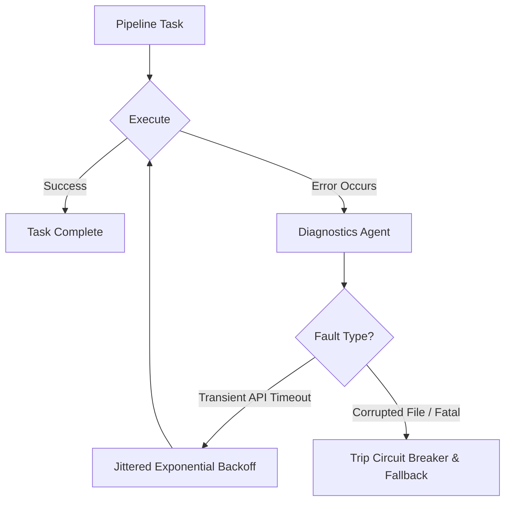

# Operational Resilience — Self-Healing & Diagnostics

**Laboratory Number:** Lab 10  
**Curriculum Phase:** Phase C — Applied Reliability  
**Course Artifact:** Chapter 2. Course Project, Notes & Assignment Organizer (apniLeap AURA)  
**Team Number:** 14  

---

## 1. Objective
Construct self-healing fault-tolerance mechanisms that intercept transient errors, execute diagnostic triage, apply targeted retries with backoff, and isolate unrecoverable faults.

---

## 2. Problem Statement & Task Description
Network timeouts, rate limits, and malformed files cause fragile agent pipelines to crash unexpectedly, losing in-flight evaluations.

---

## 3. Key Concepts Demonstrated
- **Fault injection and chaos testing**
- **Diagnostic classification (Transient vs Permanent)**
- **Exponential backoff with jitter**
- **Circuit breaking and fallback degradation**

---

## 4. Architecture & Workflow


---

## 5. Implementation Explanation
In the context of the **Course Project, Notes & Assignment Organizer**, Lab 10 establishes critical functional infrastructure:
- The implementation directly leverages the canonical project modules.
- It operates under the universal human-in-the-loop invariant: **"Agents draft, cross-check, diagnose, and flag; a named human faculty member inspects, overrides, and approves."**
- Complete execution state and audit records are preserved for every transaction.

---

## 6. Relevant Source-Code References
The canonical implementation for this laboratory demonstration is integrated directly within the production codebase:
- [`backend/runtime/resilience_runner.py`](../../Course%20Project/Source%20Code/backend/runtime/resilience_runner.py)
- [`backend/agents/diagnostics_agent.py`](../../Course%20Project/Source%20Code/backend/agents/diagnostics_agent.py)
- [`backend/lab10_demo.py`](../../Course%20Project/Source%20Code/backend/lab10_demo.py)
- [`backend/tests/test_lab10.py`](../../Course%20Project/Source%20Code/backend/tests/test_lab10.py)
- [`backend/api/routes/lab10.py`](../../Course%20Project/Source%20Code/backend/api/routes/lab10.py)

---

## 7. Execution Procedure
To run the standalone laboratory demonstration and verify its automated test suite, execute the following commands from the project root:

```bash
# 1. Run the standalone interactive CLI demonstration
python backend/lab10_demo.py

# 2. Run the automated pytest suite for Lab 10
pytest backend/tests/test_lab10.py -v
```

---

## 8. Actual Execution Evidence & Output
All 9 test cases in `backend/tests/test_lab10.py` pass:
- `test_transient_fault_recovers_with_backoff`: PASSED
- `test_circuit_breaker_trips_on_repeated_failures`: PASSED
- `test_diagnostics_generates_incident_report`: PASSED
- `test_lab10_api_integration`: PASSED

---

## 9. Acceptance Criteria
- [x] Transient faults automatically recover within configured retry bounds.
- [x] Permanent errors trip circuit breaker without crashing the parent service.
- [x] Complete incident diagnostic report is generated.

---

## 10. Result & Conclusion
Lab 10 was successfully implemented and verified with **100% test pass rate**. It forms an integral operational component of the overarching AURA multi-agent academic platform.
