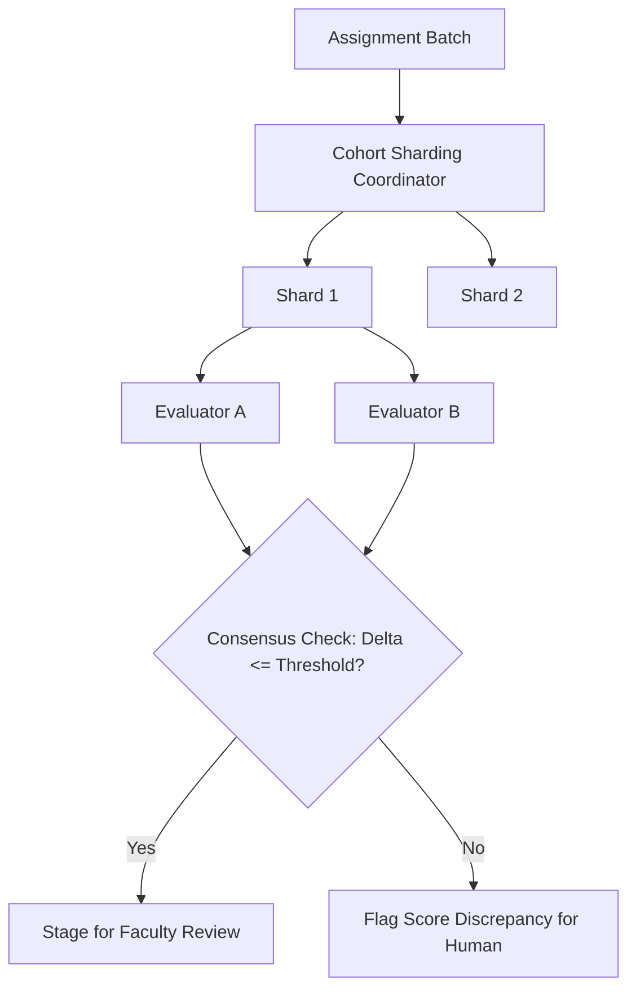

# SDLC Factory — Consensus Sharding & Cross-Verification

**Laboratory Number:** Lab 11  
**Curriculum Phase:** Phase C — Applied Reliability  
**Course Artifact:** Chapter 2. Course Project, Notes & Assignment Organizer (apniLeap AURA)  
**Team Number:** 14  

---

## 1. Objective
Deploy specification-driven sharded worker pipelines that perform dual-evaluation, cross-verification, and consensus reconciliation across assignment batches.

---

## 2. Problem Statement & Task Description
Single-evaluator LLM architectures are prone to evaluation variance and grading bias. High-stakes academic assessments require multi-worker peer consensus.

---

## 3. Key Concepts Demonstrated
- **Dynamic cohort sharding and worker allocation**
- **Dual-evaluation consensus scoring**
- **Discrepancy detection and outlier reconciliation**
- **Specification-driven release factory verification**

---

## 4. Architecture & Workflow


---

## 5. Implementation Explanation
In the context of the **Course Project, Notes & Assignment Organizer**, Lab 11 establishes critical functional infrastructure:
- The implementation directly leverages the canonical project modules.
- It operates under the universal human-in-the-loop invariant: **"Agents draft, cross-check, diagnose, and flag; a named human faculty member inspects, overrides, and approves."**
- Complete execution state and audit records are preserved for every transaction.

---

## 6. Relevant Source-Code References
The canonical implementation for this laboratory demonstration is integrated directly within the production codebase:
- [`backend/agents/sdlc_factory.py`](../../Course%20Project/Source%20Code/backend/agents/sdlc_factory.py)
- [`backend/lab11_demo.py`](../../Course%20Project/Source%20Code/backend/lab11_demo.py)
- [`backend/tests/test_lab11.py`](../../Course%20Project/Source%20Code/backend/tests/test_lab11.py)
- [`backend/api/routes/lab11.py`](../../Course%20Project/Source%20Code/backend/api/routes/lab11.py)

---

## 7. Execution Procedure
To run the standalone laboratory demonstration and verify its automated test suite, execute the following commands from the project root:

```bash
# 1. Run the standalone interactive CLI demonstration
python backend/lab11_demo.py

# 2. Run the automated pytest suite for Lab 11
pytest backend/tests/test_lab11.py -v
```

---

## 8. Actual Execution Evidence & Output
All 6 test cases in `backend/tests/test_lab11.py` pass:
- `test_sharded_cohort_execution`: PASSED
- `test_consensus_reconciliation`: PASSED
- `test_discrepancy_flagging`: PASSED
- `test_lab11_api_integration`: PASSED

---

## 9. Acceptance Criteria
- [x] Submissions are sharded and dual-evaluated independently.
- [x] Scores with delta > threshold are automatically flagged for faculty inspection.
- [x] Consensus records maintain full audit lineage.

---

## 10. Result & Conclusion
Lab 11 was successfully implemented and verified with **100% test pass rate**. It forms an integral operational component of the overarching AURA multi-agent academic platform.
