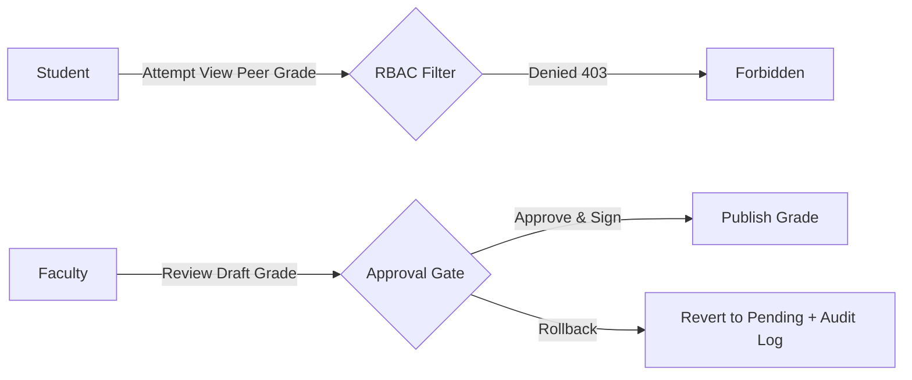

# Safety & Governance — RBAC, Privacy & Governed Rollback

**Laboratory Number:** Lab 12  
**Curriculum Phase:** Phase D — Governance and Capstone  
**Course Artifact:** Chapter 2. Course Project, Notes & Assignment Organizer (apniLeap AURA)  
**Team Number:** 14  

---

## 1. Objective
Enforce institutional safety rules: role-based access control (RBAC), student privacy isolation, mandatory faculty approval for grade publishing, and audited one-click rollback.

---

## 2. Problem Statement & Task Description
Autonomous publishing of grades without human oversight violates university policy. Furthermore, students must never be allowed to view peer submissions, similarity flags, or draft grades.

---

## 3. Key Concepts Demonstrated
- **Role-Based Access Control (Faculty, Student, HoD)**
- **Strict cross-tenant and peer privacy boundaries**
- **Approval gate invariant: only faculty can publish**
- **Atomic state rollback with full audit logging**

---

## 4. Architecture & Workflow


---

## 5. Implementation Explanation
In the context of the **Course Project, Notes & Assignment Organizer**, Lab 12 establishes critical functional infrastructure:
- The implementation directly leverages the canonical project modules.
- It operates under the universal human-in-the-loop invariant: **"Agents draft, cross-check, diagnose, and flag; a named human faculty member inspects, overrides, and approves."**
- Complete execution state and audit records are preserved for every transaction.

---

## 6. Relevant Source-Code References
The canonical implementation for this laboratory demonstration is integrated directly within the production codebase:
- [`backend/runtime/governance.py`](../../Course%20Project/Source%20Code/backend/runtime/governance.py)
- [`backend/runtime/audit.py`](../../Course%20Project/Source%20Code/backend/runtime/audit.py)
- [`backend/services/grade_publishing_service.py`](../../Course%20Project/Source%20Code/backend/services/grade_publishing_service.py)
- [`backend/services/faculty_approval_service.py`](../../Course%20Project/Source%20Code/backend/services/faculty_approval_service.py)
- [`backend/lab12_demo.py`](../../Course%20Project/Source%20Code/backend/lab12_demo.py)
- [`backend/tests/test_lab12.py`](../../Course%20Project/Source%20Code/backend/tests/test_lab12.py)
- [`backend/api/routes/lab12.py`](../../Course%20Project/Source%20Code/backend/api/routes/lab12.py)

---

## 7. Execution Procedure
To run the standalone laboratory demonstration and verify its automated test suite, execute the following commands from the project root:

```bash
# 1. Run the standalone interactive CLI demonstration
python backend/lab12_demo.py

# 2. Run the automated pytest suite for Lab 12
pytest backend/tests/test_lab12.py -v
```

---

## 8. Actual Execution Evidence & Output
All 12 test cases in `backend/tests/test_lab12.py` pass:
- `test_student_cannot_view_peer_grades`: PASSED
- `test_autonomous_agent_cannot_publish_grades`: PASSED
- `test_faculty_approval_publishes_grade`: PASSED
- `test_rollback_reverts_published_status`: PASSED
- `test_audit_records_all_governance_actions`: PASSED

---

## 9. Acceptance Criteria
- [x] Students attempting to access other students' grades receive 403 Forbidden.
- [x] Publishing API rejects any request without valid faculty authorization.
- [x] Rollback successfully resets status to approved/pending with audit log.

---

## 10. Result & Conclusion
Lab 12 was successfully implemented and verified with **100% test pass rate**. It forms an integral operational component of the overarching AURA multi-agent academic platform.
