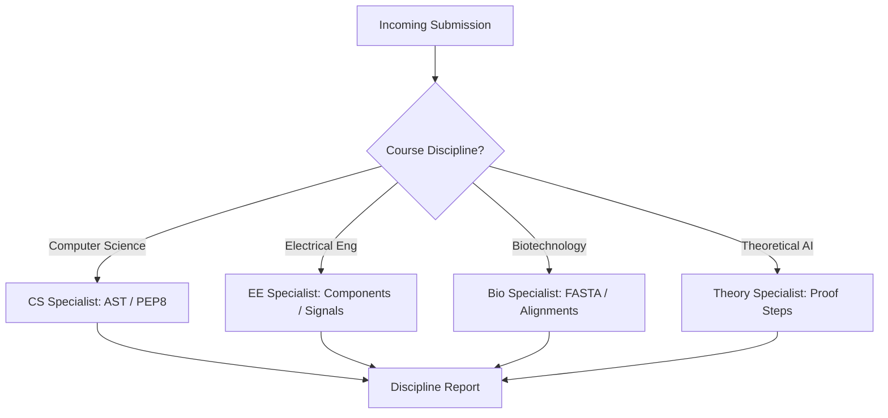

# Domain Specialists — Multi-Discipline Evaluation

**Laboratory Number:** Lab 13  
**Curriculum Phase:** Phase D — Governance and Capstone  
**Course Artifact:** Chapter 2. Course Project, Notes & Assignment Organizer (apniLeap AURA)  
**Team Number:** 14  

---

## 1. Objective
Integrate domain-specialist evaluators tailored for distinct university disciplines: Computer Science (code & AST), Electrical Engineering (circuits & components), Biotechnology (sequences), and Theory (mathematical proofs).

---

## 2. Problem Statement & Task Description
Generic grading prompts fail on specialized technical deliverables such as Python syntax checks, circuit component bounds, DNA FASTA sequences, and formal proof steps.

---

## 3. Key Concepts Demonstrated
- **Discipline-specific specialist agents**
- **Dynamic discipline routing based on course metadata**
- **Domain-tailored evaluation criteria and validators**
- **Polymorphic grading report consolidation**

---

## 4. Architecture & Workflow


---

## 5. Implementation Explanation
In the context of the **Course Project, Notes & Assignment Organizer**, Lab 13 establishes critical functional infrastructure:
- The implementation directly leverages the canonical project modules.
- It operates under the universal human-in-the-loop invariant: **"Agents draft, cross-check, diagnose, and flag; a named human faculty member inspects, overrides, and approves."**
- Complete execution state and audit records are preserved for every transaction.

---

## 6. Relevant Source-Code References
The canonical implementation for this laboratory demonstration is integrated directly within the production codebase:
- [`backend/agents/domain_specialists.py`](../../Course%20Project/Source%20Code/backend/agents/domain_specialists.py)
- [`backend/lab13_demo.py`](../../Course%20Project/Source%20Code/backend/lab13_demo.py)
- [`backend/tests/test_lab13.py`](../../Course%20Project/Source%20Code/backend/tests/test_lab13.py)
- [`backend/api/routes/lab13.py`](../../Course%20Project/Source%20Code/backend/api/routes/lab13.py)

---

## 7. Execution Procedure
To run the standalone laboratory demonstration and verify its automated test suite, execute the following commands from the project root:

```bash
# 1. Run the standalone interactive CLI demonstration
python backend/lab13_demo.py

# 2. Run the automated pytest suite for Lab 13
pytest backend/tests/test_lab13.py -v
```

---

## 8. Actual Execution Evidence & Output
All 11 test cases in `backend/tests/test_lab13.py` pass:
- `test_cs_specialist_pep8_ast`: PASSED
- `test_ee_specialist_circuit_checks`: PASSED
- `test_bio_specialist_sequence_validation`: PASSED
- `test_theory_specialist_proof_steps`: PASSED
- `test_lab13_api_integration`: PASSED

---

## 9. Acceptance Criteria
- [x] Specialist agents correctly parse domain-specific file formats.
- [x] Validates discipline criteria accurately.
- [x] Consolidated output matches the standard grading draft format.

---

## 10. Result & Conclusion
Lab 13 was successfully implemented and verified with **100% test pass rate**. It forms an integral operational component of the overarching AURA multi-agent academic platform.
