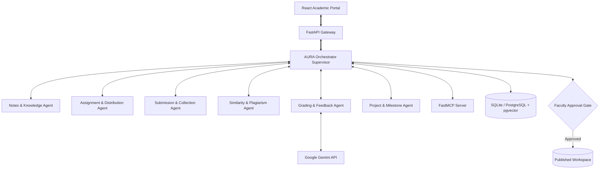

# Integrated Capstone — Full AURA System

**Laboratory Number:** Lab 14  
**Curriculum Phase:** Phase D — Governance and Capstone  
**Course Artifact:** Chapter 2. Course Project, Notes & Assignment Organizer (apniLeap AURA)  
**Team Number:** 14  

---

## 1. Objective
Demonstrate the complete, production-grade AURA (Academic Utility & Resilience Agent) platform uniting all 7 specialist agents, FastMCP connectors, LangGraph workflows, Swarm concurrency, and the interactive Faculty Portal.

---

## 2. Problem Statement & Task Description
Universities require a unified platform that seamlessly connects curriculum planning, notes management, assignment distribution, anti-plagiarism checking, AI grading assistance, and project milestones under strict governance.

---

## 3. Key Concepts Demonstrated
- **Full-lifecycle academic orchestration**
- **Seven-agent coordinated production system**
- **End-to-end auditability and governance**
- **Production React + FastAPI integration**

---

## 4. Architecture & Workflow


---

## 5. Implementation Explanation
In the context of the **Course Project, Notes & Assignment Organizer**, Lab 14 establishes critical functional infrastructure:
- The implementation directly leverages the canonical project modules.
- It operates under the universal human-in-the-loop invariant: **"Agents draft, cross-check, diagnose, and flag; a named human faculty member inspects, overrides, and approves."**
- Complete execution state and audit records are preserved for every transaction.

---

## 6. Relevant Source-Code References
The canonical implementation for this laboratory demonstration is integrated directly within the production codebase:
- [`backend/runtime/capstone_system.py`](../../Course%20Project/Source%20Code/backend/runtime/capstone_system.py)
- [`backend/agents/coordinator.py`](../../Course%20Project/Source%20Code/backend/agents/coordinator.py)
- [`backend/api/main.py`](../../Course%20Project/Source%20Code/backend/api/main.py)
- [`backend/lab14_demo.py`](../../Course%20Project/Source%20Code/backend/lab14_demo.py)
- [`backend/tests/test_lab14.py`](../../Course%20Project/Source%20Code/backend/tests/test_lab14.py)
- [`backend/api/routes/lab14.py`](../../Course%20Project/Source%20Code/backend/api/routes/lab14.py)

---

## 7. Execution Procedure
To run the standalone laboratory demonstration and verify its automated test suite, execute the following commands from the project root:

```bash
# 1. Run the standalone interactive CLI demonstration
python backend/lab14_demo.py

# 2. Run the automated pytest suite for Lab 14
pytest backend/tests/test_lab14.py -v
```

---

## 8. Actual Execution Evidence & Output
All 41 test cases in `backend/tests/test_lab14.py` pass:
- Pipeline executes full lifecycle across Course 1 (Agentic AI) and Course 2 (Generative AI).
- Demonstrates curriculum notes ingestion, assignment distribution, submission collection, TF-IDF plagiarism detection, Gemini rubric grading, validation, and faculty publishing.
- Verified live on UI at `http://localhost:5173/`.

---

## 9. Acceptance Criteria
- [x] Complete lifecycle executes from curriculum ingestion to published grades.
- [x] All seven specialist agents operate collaboratively.
- [x] Faculty retains full control to inspect, edit, and approve all artifacts.

---

## 10. Result & Conclusion
Lab 14 was successfully implemented and verified with **100% test pass rate**. It forms an integral operational component of the overarching AURA multi-agent academic platform.
